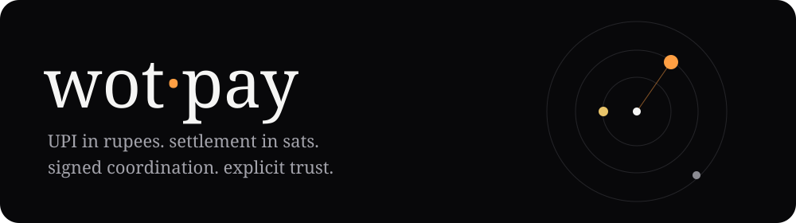
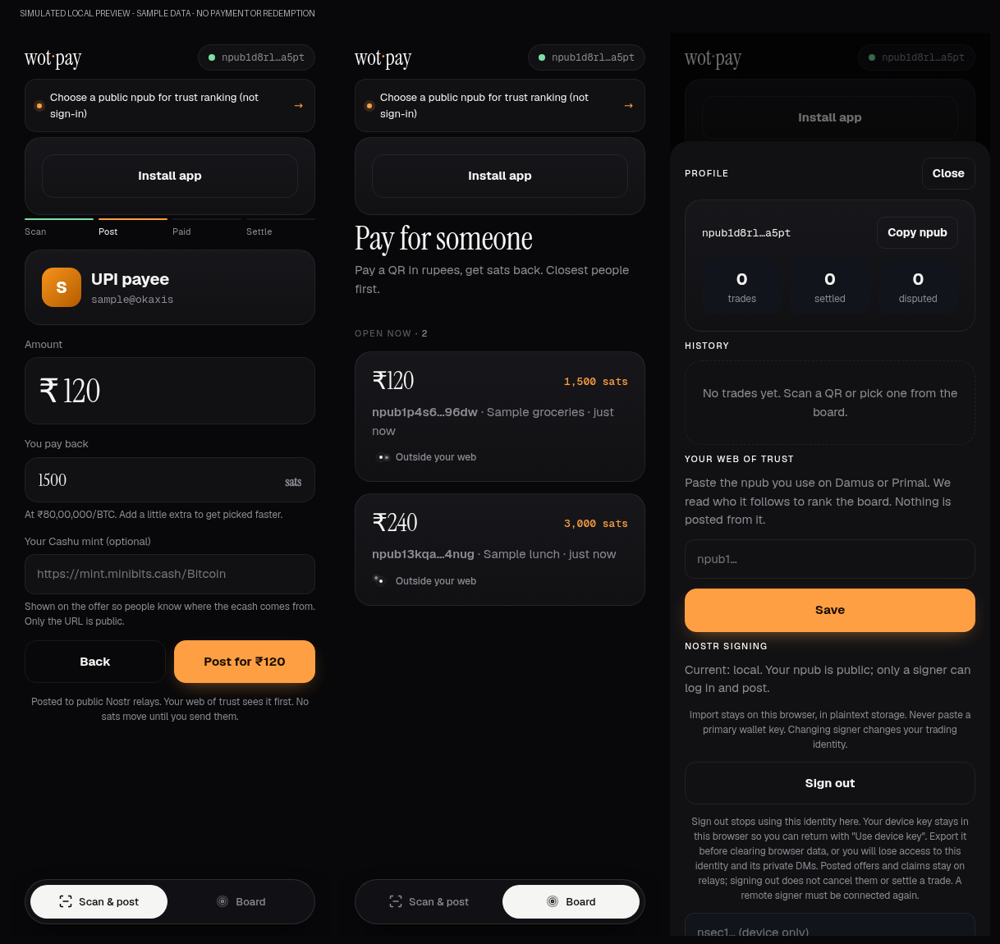

<div align="center">



**scan a UPI QR. let your web of trust do the matching. settle in sats.**

[Live demo](https://wot-pay.vercel.app/) · [Demo video](https://youtube.com/shorts/HrDpkWDtRf0) · [Phone checklist](docs/device-checklist.md) · [MIT](LICENSE)

Freedom Stack (Nostr + Ecash) · BOSS Battle, Bitshala · built by siddhant

</div>



*Local UI preview with sample offers, not live relay data or proof of payment.*

## why

UPI and sats don't share a payment rail. I built a Nostr client that lets someone post a UPI payment request and someone else pay it in exchange for sats. No bridge server holds the funds. The trade still depends on people keeping their promises.

This is a hackathon prototype for signed payment coordination. It does not verify payments or guarantee settlement.

## Client-side protected marketplace

This branch implements private quotes, payer advertisements, immutable agreements and a Cashu escrow adapter. **Real mint operations default to disabled** until deployment configuration and provider integration checks pass. No custom backend is introduced.

- Browse first; Pay a QR / Earn sats / My trades. Dismissible example, opt-in camera, image and manual UPI entry. Older public offers are collapsed separately.
- Fixed or market-linked prices, unrestricted premiums and discounts, trust/history ranking and mint filters. Both people accept exact amounts before funding.
- Signed private messages inside Nostr gift wraps; public advertisements exclude VPA, payee and QR details. Private agreements and operation journals are encrypted in IndexedDB.
- Permanent requester/payer/arbitrator 2-of-3 Cashu locks with SIG_ALL output binding, DLEQ validation, release/refund/mutual split, exact-request retries, recipient payout verification and collection for an external Cashu wallet.
- A separate 1% requester fee, rounded up, locked to the configured fee recipient and bound to the agreement. Manual fee-refund request and operator case export.
- Three-host encrypted Blossom backups, two verified copies before consuming operations, two verified relay pointers for discovery, automatic repair while open, and recovery from an older downloaded kit.

Copy [.env.example](.env.example) to .env to configure public arbitrator and fee-recipient keys. Keep mint operations disabled until the [release gates and limitations](docs/client-marketplace-v1.md) are addressed. Tests use an in-process mint and storage fixtures, not real funds. Public Nostr history is not proof of a UPI payment. Reviewed reputation penalties and production operator processes remain release work.

A device identity is currently required for private trade signing and storage. The local identity key remains in browser storage; encryption does not protect against a compromised browser or same-origin script. The recovery kit contains its secret and must be protected like a private key. External signers can browse; their private escrow integration is not implemented.

## Legacy flow (existing offers only)


```text
scan or type UPI -> signed offer -> claim -> pay UPI externally
                                          -> send sats externally -> both stamp
```

1. The maker scans a QR or types a UPI ID, sets INR and sats, and posts an offer.
2. Share the public offer link using Copy public offer link. A recipient opens it directly on the board; no automatic message is sent to your follows.
3. The board ranks offers using follows, hop distance and public settled/disputed stamps. It also shows people outside your graph.
4. The taker claims and opens their UPI app. The app does not verify that payment.
5. The maker sends Lightning from their wallet, or pastes an existing Cashu token for private delivery.
6. Each side stamps settled or disputed. These are signed statements, not verified payment receipts.

## the trust orbit

The orbit shows how far a key is from your chosen graph root: yourself, a direct follow, a distant hop, or an outsider. The browser fetches up to two follow-list layers by default. Settles raise the ranking score; pending complaints remain visible without a misconduct penalty. Only stamps from authors in your graph count.

Following someone is not a payment guarantee. In-graph collusion can manufacture reputation, even when the referenced signed offer and claim exist. The ranker requires trade existence and maker/taker participation, but cannot prove money changed hands. A pasted npub selects whose follows to read; it does not authenticate you as that person.

Add/remove follows inside Profile under People I follow / trust. Each edit is reviewed and explicitly confirmed before publishing a merged standard Nostr follow list. It edits the signed-in identity, not a pasted third-party graph. Relay omissions can still hide the latest list.

## what stays public, and what stays private

- Offers include the UPI ID, payee name, amount, sats and optional mint URL. They are public on Nostr relays. Graph ranking is not access control.
- Claims, receive hints and settled/disputed stamps are public signed events: kinds 3401, 3402, 3403 and 3404. Claim releases use signed kind-5 deletion requests.
- Cashu tokens move as NIP-17 encrypted gift wraps, not public offer content. A token-shaped-value fence checks outgoing content and tags. It is a leak-prevention heuristic, not a guarantee against every encoded secret.
- Signatures detect changes to an event. Relays can still read public events, refuse delivery or disappear. The app uses relay.damus.io, nos.lol and relay.primal.net; there is no relay editor in the UI.

## cashu hand-off

Cashu is integrated as token delivery, not as a wallet or escrow. The maker pastes a token from their own wallet. The app reads its mint, amount and unit, refuses short/wrong-unit/wrong-mint sends, encrypts it to the taker, and offers Copy token / Open wallet on receipt.

The app does not mint, redeem, verify unspent proofs or lock funds. "Sent" means a relay accepted the encrypted message, not that the recipient redeemed money. The sender retains the bearer token and could spend it first. Redeem it in a compatible wallet before claiming settlement. Trust in the Cashu mint remains.

Token DMs require the device-generated key. A NIP-07 extension signs public events but currently cannot wrap/open token DMs here; use Lightning for that path. Device nsec import/export and persisted signer choice are implemented. A bunker-link NIP-46 path is implemented with secure relay validation, timeout and signed-event checks. It has local tests rather than a live remote-signer demonstration. Never send your nsec in chat.

## agent (optional)

A separate rules-based daemon claims offers from the owner's direct follows, within an amount limit, and privately asks the owner to pay. It handles `paid`, `skip`, `got`, `no`, `status`, `pause` and `resume`. It never opens UPI or sends money. It is not hosted by the Vercel demo.

```sh
OWNER=npub1... LN_ADDRESS=you@wallet.com MAX_INR=500 npm run agent
```

The daemon has its own `.agent-key`. Active trade state and signed delivery queue persist in `.agent-state.json`, tied to the owner and agent key. Failed messages retry in order; final success waits for the stamp to publish. Skip sends a signed claim deletion request that updated clients honor. Paid-trade recovery and restart handling have local regression tests. Do not leave it managing real trades unattended.

## run it

Node 22.12 or newer and npm. No application database, API key or backend service.

```sh
git clone https://github.com/SIDDHANTCOOKIE/wot-pay.git
cd wot-pay
npm ci
npm test
npm run dev
```

On first load, browse as a guest. Choose an identity when you want to act on an existing trade. Creating a key is explicit; guest mode is read-only. A device key is stored in plaintext localStorage, with an explicit export/import backup UI. Clearing site data loses that identity and access to its encrypted messages. Treat this as a demo key, not your primary wallet key.

For a no-money preview, browse the labeled example or enter a sample UPI ID and compare fixed/market pricing. New request publication is disabled on this branch.

Camera access needs HTTPS on a phone. Use the [live demo](https://wot-pay.vercel.app/) and [phone checklist](docs/device-checklist.md). Use a test mint for ecash demonstrations and do not pay a real UPI request without deciding to spend that money.

```sh
npm run build   # dist/
npm run preview
```

`npm run smoke` publishes public test events with throwaway keys and reads them back. It is not read-only and does not test payment settlement.

## scope

The screenshots show signed sample offers and the post, board and profile screens. They show coordination, not completed payments. UPI and Lightning payments happen in external apps; Cashu tokens are handed off privately and redeemed in an external wallet.

The app checks event signatures, trade references and token hand-off fields. It does not confirm a bank transfer, prove Lightning delivery, redeem Cashu proofs or guarantee settlement.

Main passes 225 unit tests and the production build in CI, and CI deploys the same commit to the live demo. Run `npm test` for the current count. Open pull requests are separate from the deployed build.

## where trust remains

| Dependency | What can still go wrong |
| --- | --- |
| Counterparty | Pays or sends nothing, lies in a stamp, races claims |
| UPI bank / NPCI | INR leg stays fully intermediated; this app cannot change that |
| Cashu mint | Redemption depends on the selected mint |
| Nostr relays | Read public data, censor, omit history, go offline |
| Static host / browser | Availability and integrity of delivered code; local key storage |

There is no atomic swap, UTR verification, custody or escrow. Deterministic claim ordering only agrees when devices see the same events. A pending/lost claim is visible and payment links are withheld while pending, but the settling buffer is not finality. The browser loads one day of board events; recovery of older trades is limited. Settlement risk is made visible, not removed or economically measured.

## Earlier prototype roadmap

Protected 2-of-3 escrow is agreed future work for the marketplace; it is not implemented in this branch. See the migration release gates above.

Real-money settlement demonstrations, test-mint redemption and broader phone testing follow. The hosted app and a short demo recording are linked at the top.

Safer key storage, longer trade history and real remote-signer/daemon restart testing are follow-up work.

## license

MIT. See [LICENSE](LICENSE).
